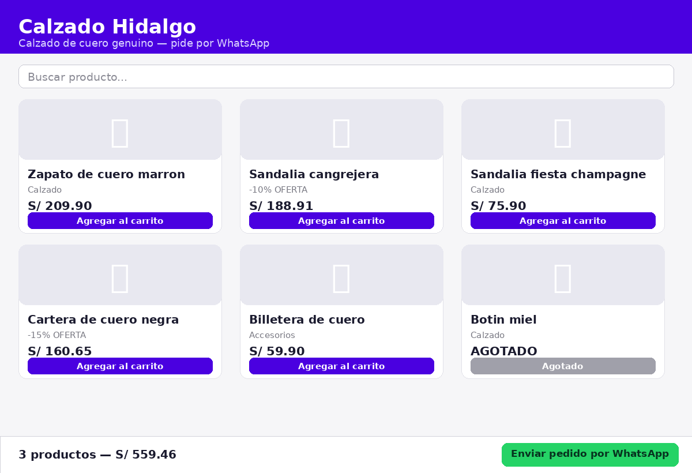
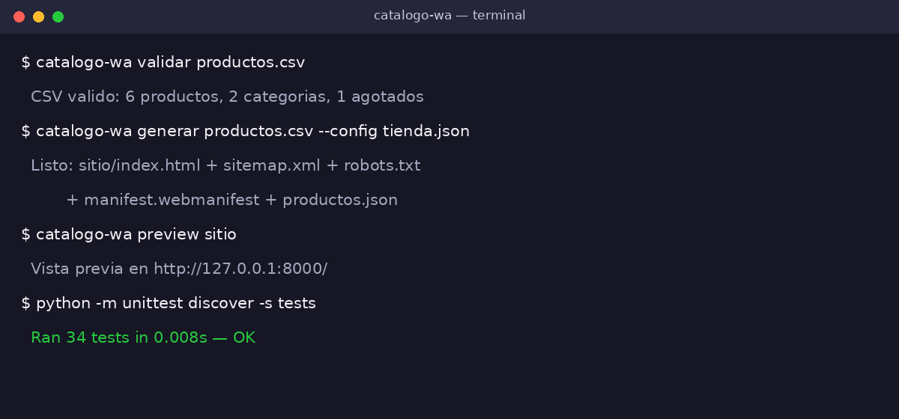

<p align="center">
  
</p>

<p align="center">
  
</p>

<p align="center">
  <a href="https://github.com/Giovanniedu/catalogo-wa/actions/workflows/tests.yml"></a>
  
  
  
  
  
</p>

## Contenido
- [Qué hace](#qué-hace-v02) · [Demo visual](#demo-visual) · [Uso](#uso) · [Ejemplo en vivo del resultado](#ejemplo-en-vivo-del-resultado) · [Pruebas y CI](#pruebas-y-ci) · [Roadmap](#roadmap) · [Contribuir](#contribuir) · [Licencia](#licencia)

## Demo visual
<p align="center"></p>
<p align="center"></p>

# catalogo-wa

[English version](README.en.md) · [Guia paso a paso](docs/guia-publicacion.md) · [Arquitectura](docs/arquitectura.md) · [Changelog](CHANGELOG.md)

**Tu tienda web gratis, sin servidor, que recibe los pedidos por WhatsApp.**

La mayoría de negocios pequeños de LatAm vende por WhatsApp pero no tiene web: mandar fotos sueltas y precios por chat es lento y se pierden pedidos. `catalogo-wa` convierte una simple lista de productos (CSV, como una hoja de Excel) en **una página web completa y publicable en minutos**: catálogo con buscador y categorías, carrito de compras, y un botón que envía el pedido ya armado —con cantidades y total— al WhatsApp del negocio.

## Qué hace (v0.2)
- Lee tus productos desde un CSV (nombre, precio, descripción, categoría, imagen, stock)
- Genera **un solo `index.html`** autocontenido (sin frameworks, sin base de datos, sin servidor)
- Buscador en vivo + filtro por categorías + productos agotados marcados
- **Carrito funcional**: cantidades, total automático y envío del pedido por WhatsApp (`wa.me`) con el mensaje ya redactado
- Precios correctos con `Decimal` (7 monedas: PEN, USD, EUR, MXN, COP, CLP, ARS)
- **Seguro por diseño**: todo dato del usuario se escapa en el HTML (anti-XSS) y los errores del CSV se reportan con número de fila
- Validación real: duplicados, precios inválidos y columnas faltantes se detectan antes de publicar

## Uso
```bash
pip install .
catalogo-wa generar examples/productos.csv --config examples/tienda.json --salida sitio
catalogo-wa validar examples/productos.csv     # revisa tu CSV antes de publicar
catalogo-wa preview sitio                        # vista previa local en el navegador
```
Con `tienda.json` configuras negocio, teléfono, moneda, **idioma (es/en/pt)**, color, mensaje de bienvenida, costo de envío, envío gratis desde un monto y **cupones de descuento**. Los productos (CSV) soportan **variantes** (tallas/colores con stock) y **descuento %** por producto.
La salida no es un solo archivo: es el paquete completo — `index.html`, `sitemap.xml`, `robots.txt`, `manifest.webmanifest` (PWA) y `productos.json` — listo para GitHub Pages / Netlify / cualquier hosting estático.

## Ejemplo en vivo del resultado
La carpeta `examples/sitio-ejemplo/` contiene la tienda generada con el CSV de ejemplo (6 productos).

## Pruebas y CI
```bash
python -m unittest discover -s tests -v   # 34 tests
```
GitHub Actions corre los tests en Python 3.10 y 3.12 en cada push y pull request.

## Roadmap
- [ ] Publicación automática a GitHub Pages con un comando
- [ ] Modo mayorista: precios por volumen
- [ ] Importar desde Google Sheets
- [ ] Panel simple de pedidos recibidos (hoja compartida)
Hecho en v0.2: multi-idioma es/en/pt, cupones, variantes, SEO/PWA, preview local.

## Contribuir
Ver `CONTRIBUTING.md` y `CODE_OF_CONDUCT.md`. Issues con plantillas incluidas.

## Licencia
MIT — libre también para uso comercial.
